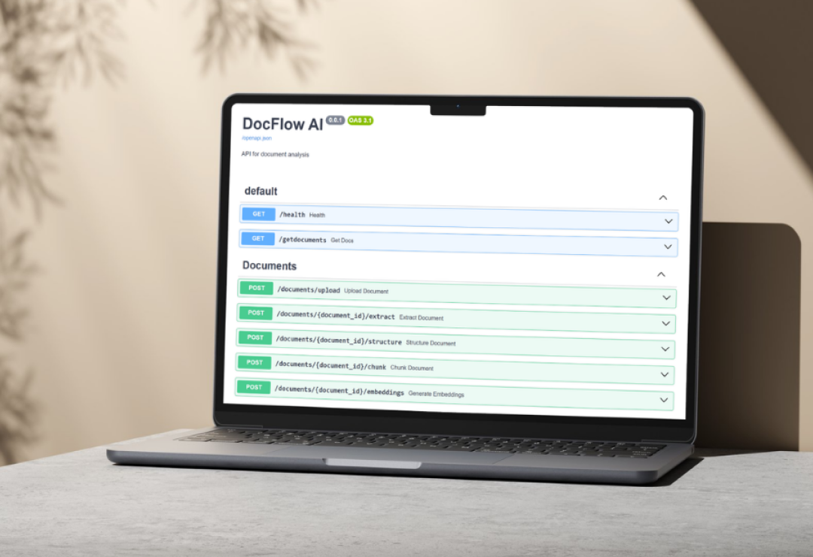
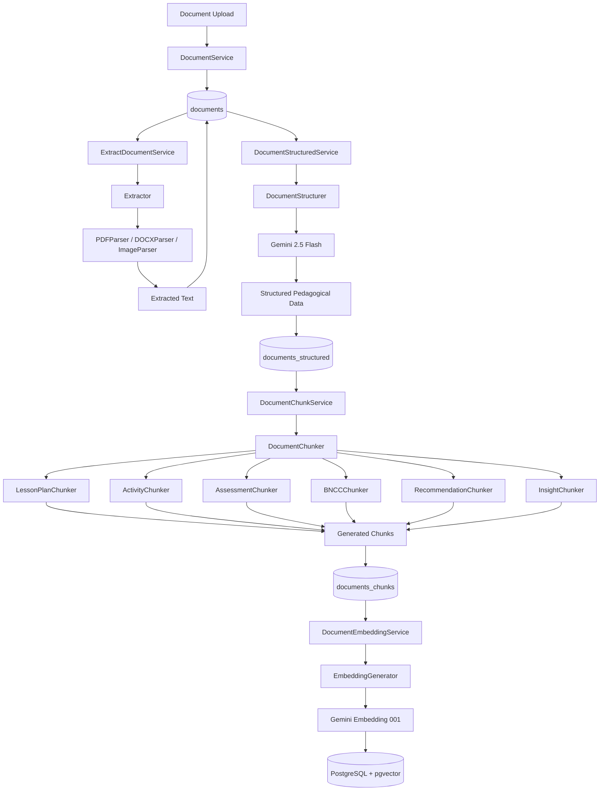
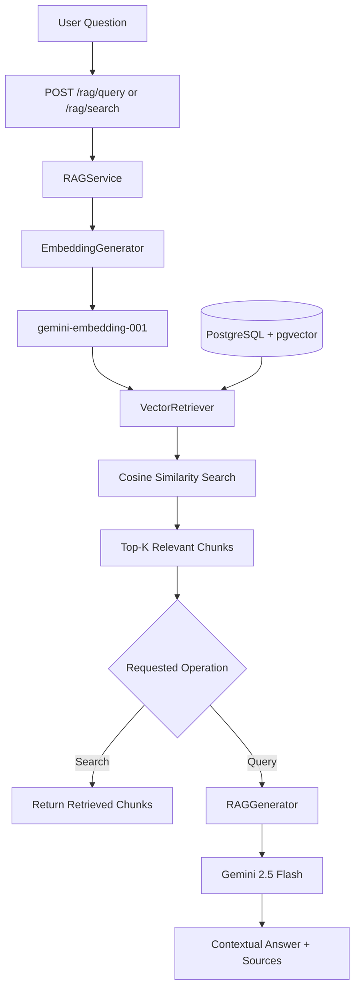
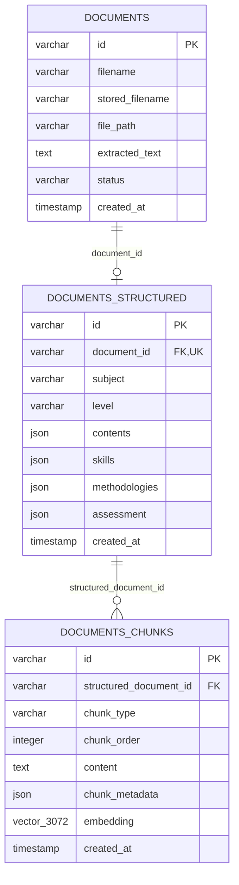

<p align="center">
  <a href="README.md"></a>
  <a href="README.pt.md"></a>
</p>

<h1 align="center">🧠 DocFlow AI</h1>

<p align="center">
  <strong>AI-powered educational document processing and semantic retrieval.</strong>
</p>

<p align="center">
  Transforming unstructured pedagogical documents into structured, searchable knowledge using OCR, LLMs, embeddings and Retrieval-Augmented Generation.
</p>

<p align="center">
  
</p>

<p align="center">
  
  
  
  
  
  
  
  
</p>

<p align="center">
  <a href="https://docflow-ai-lj3a.onrender.com/" target="_blank">
    
  </a>
</p>

---

## 📌 Project Overview

**DocFlow AI** is an AI-powered document processing platform designed to help educators organize, analyze and retrieve information from pedagogical documents.

Educational documents often contain valuable information, but extracting and finding specific content can be time-consuming when that information is stored in unstructured files.

DocFlow AI explores how OCR, Large Language Models, semantic chunking and vector search can be combined to turn these documents into structured and searchable knowledge.

The platform processes documents through an automated pipeline and makes their content available for contextual retrieval using a **Retrieval-Augmented Generation (RAG)** architecture.

## 🎯 Problem

Pedagogical information is commonly distributed across documents in different formats, making it difficult to:

- Extract relevant information from unstructured files.
- Organize content by subject, educational level and pedagogical category.
- Find specific information across multiple documents.
- Retrieve contextual information without manually reading entire files.

## 💡 Solution

DocFlow AI implements a document processing pipeline that:

1. Receives PDF, DOCX and image files.
2. Extracts text using OCR and document parsing.
3. Uses Gemini AI to structure relevant pedagogical information.
4. Divides content into semantically meaningful chunks.
5. Generates vector embeddings for each chunk.
6. Stores document information and vector representations in PostgreSQL with pgvector.
7. Retrieves relevant content through semantic similarity and uses it as context for AI-generated responses.

## ⚙️ Core Features

| Feature | Description |
|---|---|
| Document Upload | Supports PDF, DOCX and image files (PNG, JPG and JPEG), with file type and size validation. |
| Text Extraction | Extracts text through specialized parsers for PDF, DOCX and image formats. |
| AI-Powered Structuring | Uses Gemini 2.5 Flash to transform extracted text into structured pedagogical data, including subjects, educational levels, skills, methodologies and assessments. |
| Semantic Chunking | Organizes structured content into six specialized categories: lesson plans, activities, assessments, BNCC skills, recommendations and insights. |
| Vector Embeddings | Generates 3072-dimensional embeddings using `gemini-embedding-001`. |
| Semantic Search | Uses PostgreSQL and pgvector with cosine similarity to retrieve relevant document chunks. |
| Retrieval-Augmented Generation | Combines retrieved document context with Gemini 2.5 Flash to generate contextual answers and return their sources. |
| Data Persistence | Stores original documents, structured pedagogical data, semantic chunks and embeddings in PostgreSQL. |
| Automated Testing | Includes unit, integration and API route tests using Pytest. |
| CI/CD | Includes automated workflows configured with GitHub Actions and Jenkins. |

---

## 🏗️ System Architecture

DocFlow AI is organized into two main workflows: **document ingestion** and **Retrieval-Augmented Generation (RAG)**.

The backend follows a layered architecture, separating API routes, business services, AI processing modules and database persistence.

### 1. Document Ingestion Workflow

Document processing is exposed through separate API endpoints. Each endpoint triggers a specific stage of the ingestion workflow.



### 2. RAG Retrieval Workflow

After document chunks have been generated and their embeddings stored, the application can perform semantic searches and generate contextual responses.



### 3. Application Architecture

The application separates responsibilities into distinct layers:

| Layer | Responsibility |
|---|---|
| API Routes | Exposes document processing and RAG endpoints through FastAPI. |
| Services | Coordinates business logic and document processing operations. |
| AI Modules | Handles parsing, structuring, chunking, embedding generation and RAG. |
| Models | Defines database entities using SQLAlchemy ORM. |
| Database | Stores documents, structured information, chunks and vector embeddings. |

This separation makes the application easier to maintain, test and extend.

---

## 🗄️ Database Design

DocFlow AI uses **PostgreSQL**, hosted on [Neon](https://neon.tech/), with **SQLAlchemy ORM** for database interaction and **pgvector** for vector storage and semantic similarity search.

The database follows a three-entity document processing model, separating original documents, AI-structured information and semantic chunks.

### Entity Relationship Diagram



### Entity Responsibilities

| Entity | Responsibility |
|---|---|
| `documents` | Stores uploaded file information, file paths, extracted text and processing status. |
| `documents_structured` | Stores AI-structured pedagogical information, including subjects, educational levels, skills and methodologies. |
| `documents_chunks` | Stores semantically segmented content, chunk metadata and vector embeddings. |

### Relationships and Constraints

- **Documents → Structured Documents (1:0..1):** each document can have at most one structured representation, enforced by a unique foreign key on `document_id`.
- **Structured Documents → Chunks (1:N):** each structured document can contain multiple semantic chunks.
- **Referential Integrity:** foreign keys maintain relationships between document processing stages.
- **Cascade Deletion:** chunks are configured for deletion when their parent structured document is removed.

### Vector Storage

The `documents_chunks` table includes an `embedding` column implemented with **pgvector**.

- Data type: `vector(3072)`.
- Embedding model: `gemini-embedding-001`.
- Purpose: semantic representation of document chunks.
- Retrieval: cosine similarity search for contextually relevant content.

### Flexible Data Structures

JSON columns are used to store variable pedagogical information:

- `contents`: extracted educational content.
- `skills`: skills and learning objectives.
- `methodologies`: teaching methodologies.
- `assessment`: assessment-related information.
- `chunk_metadata`: additional context associated with each semantic chunk.

---

## 🔎 Retrieval-Augmented Generation (RAG)

The RAG implementation combines vector-based retrieval with Large Language Model generation.

Instead of relying only on the model's general knowledge, the application retrieves relevant information from processed documents and provides it as context for response generation.

### Query Workflow

1. The user submits a natural-language question.
2. The question is converted into an embedding using `gemini-embedding-001`.
3. pgvector performs a cosine similarity search.
4. The most relevant chunks are retrieved according to the `top_k` parameter.
5. Retrieved content is assembled into the context.
6. Gemini generates a contextual response using the retrieved information.
7. The API returns the answer and its sources.

### RAG API Endpoints

| Method | Endpoint | Description |
|---|---|---|
| `POST` | `/rag/query` | Executes the complete RAG pipeline and returns an answer with sources. |
| `POST` | `/rag/search` | Performs semantic search without generating an AI response. |

### Example Request

```json
{
  "query": "How to plan an engaging lesson on fractions?",
  "top_k": 5,
  "chunk_type": "lesson_plan"
}
```

The `top_k` parameter controls the number of chunks retrieved, while `chunk_type` can be used to filter the search by pedagogical category.

---

## 🔌 API Overview

DocFlow AI exposes RESTful endpoints through FastAPI, organized into document processing and Retrieval-Augmented Generation (RAG) operations.

### Document Processing

| Method | Endpoint | Description |
|---|---|---|
| `POST` | `/documents/upload` | Uploads and validates PDF, DOCX and image files. |
| `POST` | `/documents/{document_id}/extract` | Extracts text from an uploaded document. |
| `POST` | `/documents/{document_id}/structure` | Converts extracted text into structured pedagogical data using Gemini. |
| `POST` | `/documents/{document_id}/chunk` | Splits structured content into specialized semantic chunks. |
| `POST` | `/documents/{document_id}/embeddings` | Generates vector embeddings for document chunks. |

### Retrieval-Augmented Generation (RAG)

| Method | Endpoint | Description |
|---|---|---|
| `POST` | `/rag/search` | Retrieves semantically relevant chunks using vector similarity search. |
| `POST` | `/rag/query` | Generates contextual answers based on retrieved document content. |

### General Endpoints

| Method | Endpoint | Description |
|---|---|---|
| `GET` | `/health` | Checks whether the API is running. |
| `GET` | `/getdocuments` | Retrieves structured documents stored in the database. |

**API Documentation:** FastAPI automatically provides interactive Swagger UI documentation at `/docs` when the application is running.

---

## 🛠️ Technology Stack

| Category | Technologies |
|---|---|
| Language | Python |
| API Framework | FastAPI |
| ORM | SQLAlchemy |
| Database | PostgreSQL |
| Vector Search | pgvector |
| Generative AI | Google Gemini 2.5 Flash |
| Embeddings | `gemini-embedding-001` (3072 dimensions) |
| PDF Processing | PyMuPDF (`fitz`) |
| DOCX Processing | `python-docx` |
| Image Processing | Pillow |
| OCR | Tesseract OCR (`pytesseract`) |
| Testing | Pytest |
| Containerization | Docker |
| CI/CD | GitHub Actions, Jenkins |
| Database Hosting | Neon PostgreSQL |

---

## 🧪 Testing

The project includes automated tests to validate important parts of the application.

Test coverage includes:

- Unit tests.
- Integration tests.
- API route tests.
- Embedding-related tests.
- OCR-related tests.

### Run Tests

```bash
pytest
```

### Run Tests with Coverage

```bash
pytest --cov=app
```

---

## 🔄 CI/CD Pipeline

DocFlow AI uses GitHub Actions and Jenkins to automate Docker builds, automated testing and application deployment.

### GitHub Actions

The GitHub Actions workflow is triggered by pushes and pull requests targeting the `main` branch.

**CI workflow:**

1. Checks out the repository.
2. Builds the Docker image.
3. Runs code quality checks using Flake8.
4. Executes unit tests with Pytest.
5. Executes integration tests with coverage reporting.

**Deployment workflow:**

After a successful CI run triggered by a push to `main`:

1. Triggers deployment on Render using a deploy hook.
2. Waits for the deployment to complete.
3. Performs an API health check through the `/health` endpoint.

### Jenkins

The Jenkins pipeline automates the application lifecycle in a Docker environment.

**Pipeline stages:**

1. **Checkout:** Retrieves the source code.
2. **Build:** Builds and tags Docker images using the build number and `latest`.
3. **Testing:** Executes the Pytest suite with coverage.
4. **Deployment:** Stops and removes the previous container, then starts the updated application container.

Jenkins credentials are used to configure database connections securely.

### CI/CD Overview

| Capability | GitHub Actions | Jenkins |
|---|---|---|
| Docker Image Build | Yes | Yes |
| Code Linting | Flake8 | Not configured |
| Automated Tests | Unit and integration | Pytest suite |
| Coverage | Integration tests | Full test suite |
| Deployment | Render | Docker container |
| Health Check | API `/health` | Not configured |

Both pipelines help maintain code quality and automate application delivery through containerized workflows.

---

## 🚀 Getting Started

### Prerequisites

- Docker and Docker Compose.
- Gemini API key.

### 1. Clone the Repository

```bash
git clone https://github.com/matheusconaga/docflow-ai.git
cd docflow-ai
```

### 2. Configure Environment Variables

Create a `.env` file in the project root:

```env
DATABASE_URL=
DATABASE_TEST_URL=
GEMINI_API_KEY=
```

Fill in the values required by your local environment.

### 3. Start the Application

```bash
docker compose up --build
```

### 4. Access the API

Once the application is running, access:

```text
http://localhost:8000/docs
```

The Swagger interface provides interactive access to the available API endpoints.

### Running Without Docker

For a local Python environment:

```bash
python -m venv venv
```

Activate the environment:

```bash
# Windows PowerShell
.\venv\Scripts\Activate

# Linux / macOS
source venv/bin/activate
```

Install dependencies:

```bash
pip install -r requirements.txt
```

Make sure PostgreSQL is running and the pgvector extension is available. Configure the environment variables in `.env`, then run the database setup:

```bash
python -m app.db.create_tables
python -m app.db.migrations.add_pgvector
```

Start the API:

```bash
uvicorn app.main:app --reload
```

Open `http://localhost:8000/docs` to explore the API.

> **Processing note:** the document workflow exposes separate endpoints for extraction, structuring, chunking and embedding generation. Embeddings must be generated before documents can be used in the RAG retrieval workflow.

---

## 📄 License

Copyright © 2026 Matheus Lula. All rights reserved.

This project is intended for portfolio and educational purposes only. Unauthorized commercial use, distribution or reproduction is prohibited.

---

## 👨‍💻 About the Developer

<p align="center">
  
</p>

<h3 align="center">Matheus Lula</h3>

<p align="center"><strong>Software Engineer • Python • FastAPI • TypeScript • Node.js • PostgreSQL</strong>

</p>

I develop web applications, backend services and API integrations, with an interest in software architecture, automation and AI-powered solutions.

This project explores the application of backend engineering, vector databases and Large Language Models to solve a practical document processing problem.


<p align="center">
<a href="mailto:matheusphillip170@gmail.com"></a>
<a href="https://www.linkedin.com/in/matheusconaga/"></a>
  <a href="https://matheusconaga.dev/">
    
  </a>
  
</p>


