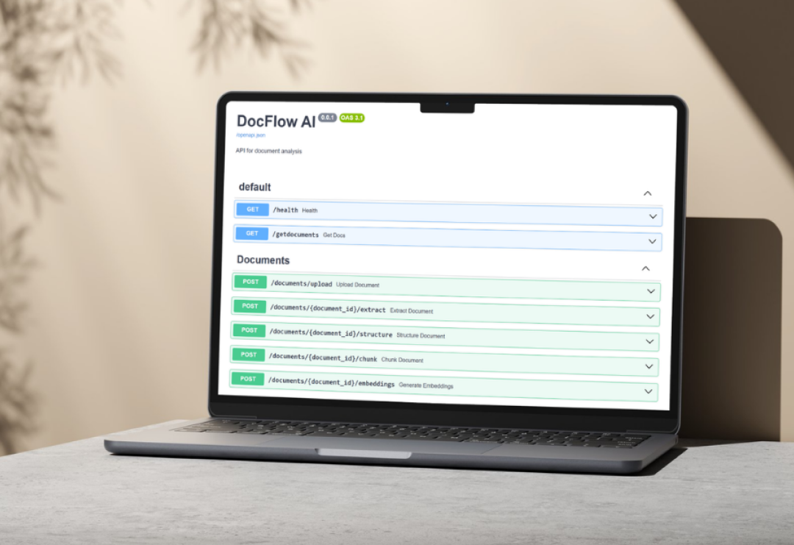
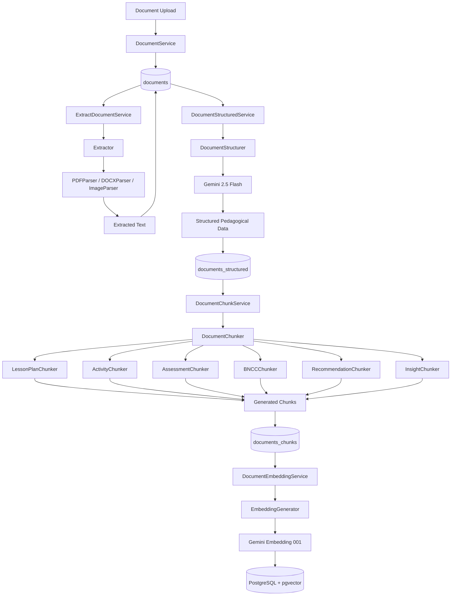
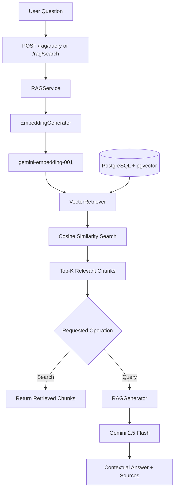
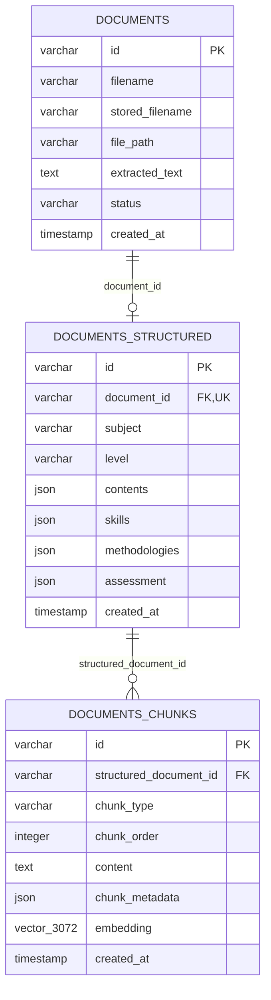

<p align="center">
  <a href="README.md"></a>
  <a href="README.pt.md"></a>
</p>

<h1 align="center">🧠 DocFlow AI</h1>

<p align="center">
  <strong>Processamento de documentos educacionais impulsionado por inteligência artificial e recuperação semântica.</strong>
</p>

<p align="center">
  Transformando documentos pedagógicos não estruturados em conhecimento estruturado e pesquisável usando OCR, LLMs, embeddings e Geração Aumentada por Recuperação (RAG).
</p>

<p align="center">
  
</p>

<p align="center">
  
  
  
  
  
  
  
  
</p>

<p align="center">
  <a href="https://docflow-ai-lj3a.onrender.com/" target="_blank">
    
  </a>
</p>

---

## 📌 Visão Geral do Projeto

O **DocFlow AI** é uma plataforma de processamento de documentos impulsionada por inteligência artificial, projetada para ajudar educadores a organizar, analisar e recuperar informações de documentos pedagógicos.

Documentos educacionais frequentemente contêm informações valiosas, mas extrair e encontrar conteúdos específicos pode ser demorado quando essas informações estão armazenadas em arquivos não estruturados.

O DocFlow AI explora como OCR, Modelos de Linguagem de Grande Escala (LLMs), *chunking* semântico e busca vetorial podem ser combinados para transformar esses documentos em conhecimento estruturado e pesquisável.

A plataforma processa documentos através de um pipeline automatizado e disponibiliza seu conteúdo para recuperação contextual usando uma arquitetura de **Geração Aumentada por Recuperação (RAG)**.

## 🎯 Problema

Informações pedagógicas são comumente distribuídas em documentos de diferentes formatos, o que dificulta:

- Extrair informações relevantes de arquivos não estruturados.
- Organizar o conteúdo por disciplina, nível educacional e categoria pedagógica.
- Encontrar informações específicas em múltiplos documentos.
- Recuperar informações contextuais sem ler arquivos inteiros manualmente.

## 💡 Solução

O DocFlow AI implementa um pipeline de processamento de documentos que:

1. Recebe arquivos PDF, DOCX e imagens.
2. Extrai texto usando OCR e parsing de documentos.
3. Utiliza o Gemini AI para estruturar informações pedagógicas relevantes.
4. Divide o conteúdo em blocos (*chunks*) semanticamente significativos.
5. Gera *embeddings* vetoriais para cada bloco.
6. Armazena informações dos documentos e representações vetoriais no PostgreSQL com pgvector.
7. Recupera conteúdo relevante por meio de similaridade semântica e o utiliza como contexto para respostas geradas por IA.

## ⚙️ Principais Funcionalidades

| Funcionalidade | Descrição |
|---|---|
| Document Upload | Suporta arquivos PDF, DOCX e imagens (PNG, JPG e JPEG), com validação de tipo e tamanho de arquivo. |
| Text Extraction | Extrai texto através de parsers especializados para os formatos PDF, DOCX e imagem. |
| AI-Powered Structuring | Utiliza o Gemini 2.5 Flash para transformar o texto extraído em dados pedagógicos estruturados, incluindo disciplinas, níveis educacionais, habilidades, metodologias e avaliações. |
| Semantic Chunking | Organiza o conteúdo estruturado em seis categorias especializadas: planos de aula, atividades, avaliações, habilidades da BNCC, recomendações e *insights*. |
| Vector Embeddings | Gera *embeddings* de 3072 dimensões usando `gemini-embedding-001`. |
| Semantic Search | Utiliza o PostgreSQL e pgvector com similaridade de cosseno para recuperar blocos de documentos relevantes. |
| Retrieval-Augmented Generation | Combina o contexto do documento recuperado com o Gemini 2.5 Flash para gerar respostas contextuais e retornar suas fontes. |
| Data Persistence | Armazena documentos originais, dados pedagógicos estruturados, blocos semânticos e *embeddings* no PostgreSQL. |
| Automated Testing | Inclui testes unitários, de integração e de rotas de API usando o Pytest. |
| CI/CD | Inclui fluxos de trabalho automatizados configurados com GitHub Actions e Jenkins. |

---

## 🏗️ Arquitetura do Sistema

O DocFlow AI é organizado em dois fluxos principais: **ingestão de documentos** e **Geração Aumentada por Recuperação (RAG)**.

O *backend* segue uma arquitetura em camadas, separando rotas de API, serviços de negócios, módulos de processamento de IA e persistência em banco de dados.

### 1. Fluxo de Ingestão de Documentos

O processamento de documentos é exposto através de endpoints de API separados. Cada endpoint aciona uma etapa específica do fluxo de ingestão.



### 2. Fluxo de Recuperação RAG

Após a geração dos blocos de documentos e o armazenamento de seus *embeddings*, a aplicação pode realizar buscas semânticas e gerar respostas contextuais.



### 3. Arquitetura da Aplicação

A aplicação separa as responsabilidades em camadas distintas:

| Camada | Responsabilidade |
|---|---|
| API Routes | Expõe endpoints de processamento de documentos e RAG por meio do FastAPI. |
| Services | Coordenam a lógica de negócios e as operações de processamento de documentos. |
| AI Modules | Tratam o *parsing*, estruturação, *chunking*, geração de *embeddings* e RAG. |
| Models | Definem as entidades do banco de dados utilizando o SQLAlchemy ORM. |
| Database | Armazena documentos, informações estruturadas, blocos e *embeddings* vetoriais. |

Essa separação torna a aplicação mais fácil de manter, testar e estender.

---

## 🗄️ Modelagem do Banco de Dados

O DocFlow AI utiliza o **PostgreSQL**, hospedado no [Neon](https://neon.tech/), com **SQLAlchemy ORM** para interação com o banco de dados e **pgvector** para armazenamento vetorial e busca por similaridade semântica.

O banco de dados segue um modelo de processamento de documentos de três entidades, separando documentos originais, informações estruturadas por IA e blocos semânticos.

### Diagrama de Relacionamento de Entidades



### Responsabilidades das Entidades

| Entidade | Responsabilidade |
|---|---|
| `documents` | Armazena informações de arquivos enviados, caminhos de arquivo, texto extraído e status de processamento. |
| `documents_structured` | Armazena informações pedagógicas estruturadas por IA, incluindo disciplinas, níveis educacionais, habilidades e metodologias. |
| `documents_chunks` | Armazena conteúdo segmentado semanticamente, metadados dos blocos e *embeddings* vetoriais. |

### Relacionamentos e Restrições

- **Documentos → Documentos Estruturados (1:0..1):** cada documento pode ter no máximo uma representação estruturada, garantida por uma chave estrangeira exclusiva em `document_id`.
- **Documentos Estruturados → Blocos (1:N):** cada documento estruturado pode conter múltiplos blocos semânticos.
- **Integridade Referencial:** chaves estrangeiras mantêm os relacionamentos entre as etapas de processamento do documento.
- **Exclusão em Cascata (Cascade Deletion):** os blocos são configurados para exclusão quando o documento estruturado pai é removido.

### Armazenamento Vetorial

A tabela `documents_chunks` inclui uma coluna `embedding` implementada com o **pgvector**.

- Tipo de dado: `vector(3072)`.
- Modelo de *embedding*: `gemini-embedding-001`.
- Propósito: representação semântica de blocos de documentos.
- Recuperação: busca por similaridade de cosseno para conteúdo contextualmente relevante.

### Estruturas de Dados Flexíveis

Colunas JSON são utilizadas para armazenar informações pedagógicas variáveis:

- `contents`: conteúdo educacional extraído.
- `skills`: habilidades e objetivos de aprendizagem.
- `methodologies`: metodologias de ensino.
- `assessment`: informações relacionadas à avaliação.
- `chunk_metadata`: contexto adicional associado a cada bloco semântico.

---

## 🔎 Geração Aumentada por Recuperação (RAG)

A implementação de RAG combina a recuperação baseada em vetores com a geração por Modelos de Linguagem de Grande Escala.

Em vez de depender apenas do conhecimento geral do modelo, a aplicação recupera informações relevantes de documentos processados e as fornece como contexto para a geração da resposta.

### Fluxo de Consulta

1. O usuário envia uma pergunta em linguagem natural.
2. A pergunta é convertida em um *embedding* usando `gemini-embedding-001`.
3. O pgvector realiza uma busca por similaridade de cosseno.
4. Os blocos mais relevantes são recuperados de acordo com o parâmetro `top_k`.
5. O conteúdo recuperado é montado no contexto.
6. O Gemini gera uma resposta contextual utilizando a informação recuperada.
7. A API retorna a resposta e suas respectivas fontes.

### Endpoints da API RAG

| Método | Endpoint | Descrição |
|---|---|---|
| `POST` | `/rag/query` | Executa o pipeline completo de RAG e retorna uma resposta com fontes. |
| `POST` | `/rag/search` | Realiza busca semântica sem gerar uma resposta de IA. |

### Exemplo de Requisição

```json
{
  "query": "How to plan an engaging lesson on fractions?",
  "top_k": 5,
  "chunk_type": "lesson_plan"
}
```

O parâmetro `top_k` controla o número de blocos recuperados, enquanto `chunk_type` pode ser usado para filtrar a busca por categoria pedagógica.

---

## 🔌 Visão Geral da API

O DocFlow AI expõe endpoints RESTful através do FastAPI, organizados em operações de processamento de documentos e Geração Aumentada por Recuperação (RAG).

### Processamento de Documentos

| Método | Endpoint | Descrição |
|---|---|---|
| `POST` | `/documents/upload` | Faz o upload e valida arquivos PDF, DOCX e imagens. |
| `POST` | `/documents/{document_id}/extract` | Extrai texto de um documento enviado. |
| `POST` | `/documents/{document_id}/structure` | Converte o texto extraído em dados pedagógicos estruturados usando o Gemini. |
| `POST` | `/documents/{document_id}/chunk` | Divide o conteúdo estruturado em blocos semânticos especializados. |
| `POST` | `/documents/{document_id}/embeddings` | Gera *embeddings* vetoriais para os blocos de documentos. |

### Geração Aumentada por Recuperação (RAG)

| Método | Endpoint | Descrição |
|---|---|---|
| `POST` | `/rag/search` | Recupera blocos semanticamente relevantes usando busca por similaridade vetorial. |
| `POST` | `/rag/query` | Gera respostas contextuais com base no conteúdo do documento recuperado. |

### Endpoints Gerais

| Método | Endpoint | Descrição |
|---|---|---|
| `GET` | `/health` | Verifica se a API está em execução. |
| `GET` | `/getdocuments` | Recupera documentos estruturados armazenados no banco de dados. |

**Documentação da API:** O FastAPI fornece automaticamente a documentação interativa do Swagger em `/docs` quando a aplicação está em execução.

---

## 🛠️ Pilha Tecnológica (Tech Stack)

| Categoria | Tecnologias |
|---|---|
| Linguagem | Python |
| Framework de API | FastAPI |
| ORM | SQLAlchemy |
| Banco de Dados | PostgreSQL |
| Busca Vetorial | pgvector |
| Inteligência Artificial Generativa | Google Gemini 2.5 Flash |
| Embeddings | `gemini-embedding-001` (3072 dimensões) |
| Processamento de PDF | PyMuPDF (`fitz`) |
| Processamento de DOCX | `python-docx` |
| Processamento de Imagem | Pillow |
| OCR | Tesseract OCR (`pytesseract`) |
| Testes | Pytest |
| Containerização | Docker |
| CI/CD | GitHub Actions, Jenkins |
| Hospedagem de Banco de Dados | Neon PostgreSQL |

---

## 🧪 Testes

O projeto inclui testes automatizados para validar partes importantes da aplicação.

A cobertura de testes inclui:

- Testes unitários.
- Testes de integração.
- Testes de rotas de API.
- Testes relacionados a *embeddings*.
- Testes relacionados a OCR.

### Executar Testes

```bash
pytest
```

### Executar Testes com Cobertura

```bash
pytest --cov=app
```

---

## 🔄 Pipeline de CI/CD

O DocFlow AI utiliza GitHub Actions e Jenkins para automatizar os *builds* do Docker, testes automatizados e implantação da aplicação.

### GitHub Actions

O fluxo de trabalho do GitHub Actions é acionado por *pushes* e *pull requests* direcionados à branch `main`.

**Fluxo de CI:**

1. Faz o *checkout* do repositório.
2. Constrói a imagem Docker.
3. Executa verificações de qualidade de código usando o Flake8.
4. Executa testes unitários com o Pytest.
5. Executa testes de integração com relatório de cobertura.

**Fluxo de Implantação (Deployment):**

Após um CI bem-sucedido acionado por um *push* na branch `main`:

1. Aciona a implantação no Render usando um *deploy hook*.
2. Aguarda a conclusão da implantação.
3. Realiza uma verificação de integridade (*health check*) da API através do endpoint `/health`.

### Jenkins

O pipeline do Jenkins automatiza o ciclo de vida da aplicação em um ambiente Docker.

**Estágios do Pipeline:**

1. **Checkout:** Recupera o código-fonte.
2. **Build:** Constrói e etiqueta as imagens Docker usando o número da build e a tag `latest`.
3. **Testing:** Executa a suíte de testes do Pytest com cobertura.
4. **Deployment:** Para e remove o container anterior, em seguida inicia o container da aplicação atualizada.

As credenciais do Jenkins são usadas para configurar as conexões com o banco de dados de forma segura.

### Visão Geral de CI/CD

| Capacidade | GitHub Actions | Jenkins |
|---|---|---|
| Build da Imagem Docker | Sim | Sim |
| Linting de Código | Flake8 | Não configurado |
| Testes Automatizados | Unitários e de integração | Suíte Pytest |
| Cobertura | Testes de integração | Suíte completa de testes |
| Implantação | Render | Container Docker |
| Health Check | API `/health` | Não configurado |

Ambos os pipelines ajudam a manter a qualidade do código e a automatizar a entrega da aplicação por meio de fluxos containerizados.

---

## 🚀 Como Começar (Getting Started)

### Pré-requisitos

- Docker e Docker Compose.
- Chave de API do Gemini (`GEMINI_API_KEY`).

### 1. Clonar o Repositório

```bash
git clone [https://github.com/matheusconaga/docflow-ai.git](https://github.com/matheusconaga/docflow-ai.git)
cd docflow-ai
```

### 2. Configurar Variáveis de Ambiente

Crie um arquivo `.env` na raiz do projeto:

```env
DATABASE_URL=
DATABASE_TEST_URL=
GEMINI_API_KEY=
```

Preencha com os valores exigidos pelo seu ambiente local.

### 3. Iniciar a Aplicação

```bash
docker compose up --build
```

### 4. Acessar a API

Assim que a aplicação estiver em execução, acesse:

```text
http://localhost:8000/docs
```

A interface do Swagger oferece acesso interativo aos endpoints disponíveis na API.

### Executando Sem o Docker

Para um ambiente Python local:

```bash
python -m venv venv
```

Ative o ambiente:

```bash
# Windows PowerShell
.\venv\Scripts\Activate

# Linux / macOS
source venv/bin/activate
```

Instale as dependências:

```bash
pip install -r requirements.txt
```

Certifique-se de que o PostgreSQL está rodando e a extensão pgvector está disponível. Configure as variáveis de ambiente no arquivo `.env` e execute a configuração do banco de dados:

```bash
python -m app.db.create_tables
python -m app.db.migrations.add_pgvector
```

Inicie a API:

```bash
uvicorn app.main:app --reload
```

Abra `http://localhost:8000/docs` para explorar a API.

> **Nota de processamento:** o fluxo de documentos expõe endpoints separados para extração, estruturação, *chunking* e geração de *embeddings*. Os *embeddings* devem ser gerados antes que os documentos possam ser utilizados no fluxo de recuperação RAG.

---

## 📄 Licença

Copyright © 2026 Matheus Lula. Todos os direitos reservados.

Este projeto destina-se estritamente a fins de portfólio e educacionais. O uso comercial, distribuição ou reprodução não autorizados são proibidos.

---

## 👨‍💻 Sobre o Desenvolvedor

<p align="center">
  
</p>

<h3 align="center">Matheus Lula</h3>

<p align="center"><strong>Software Engineer • Python • FastAPI • TypeScript • Node.js • PostgreSQL</strong>

</p>

Desenvolvo aplicações web, serviços de *backend* e integrações de API, com interesse em arquitetura de software, automação e soluções impulsionadas por IA.

Este projeto explora a aplicação de engenharia de *backend*, bancos de dados vetoriais e Modelos de Linguagem de Grande Escala para resolver um problema prático de processamento de documentos.


<p align="center">
<a href="mailto:matheusphillip170@gmail.com"></a>
<a href="https://www.linkedin.com/in/matheusconaga/"></a>
  <a href="https://matheusconaga.dev/">
    
  </a>
</p>